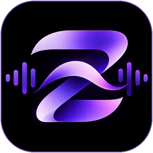

# Zuri Flow

<p align="center">
  
</p>

<p align="center">
  <strong>Local-first voice dictation for Windows, powered by DeepSeek.</strong><br>
  Press a key, speak in English or Hinglish, and paste cleaned text into any app.
</p>

---

## What is Zuri Flow?

Zuri Flow is a small Windows dictation app inspired by Wispr Flow. It runs in the
background with a tiny floating HUD, records from your microphone, sends the audio
to DeepSeek Speech-to-Text, cleans up the transcript with DeepSeek Chat, and pastes
the result into the text field you were using.

It is built for fast prompting, coding notes, AI chats, and mixed
English/Hinglish dictation.

## Features

- Global **toggle** and **hold-to-talk** hotkeys (keyboard or mouse buttons)
- Microphone and speaker selection in Settings
- Tiny draggable HUD with a 60 px edge magnet
- HUD docks vertically on left/right edges and horizontally on top/bottom
- Taskbar-aware work-area clamping
- Background system-audio mute while recording, restored afterward
- DeepSeek ASR + cleanup using your own API key
- API key can be changed inside the app at any time
- English and Hinglish output in Latin script only
- Optional numbered-list formatting when you dictate steps
- Floating HUD stays separate from the main window
- Main window with History and Settings
- Hover **Copy / Paste / Delete** actions on history items
- Local SQLite history with automatic 2-day cleanup
- Close window to tray; quit from tray to end the process
- Dark UI, app logo, tray icon and shortcut icon included

## Important: API key support

**Zuri Flow currently supports only a DeepSeek API key.**

It uses these DeepSeek endpoints directly:

- `POST https://api.deepseek.com/v1/tools/asr`
- `POST https://api.deepseek.com/chat/completions`
- Model: `deepseek-flash`

An OpenAI, Anthropic, Gemini, Groq or other provider key will **not** work as-is.
Support for other providers would require a new adapter/configuration layer.

Your key is stored in **Windows Credential Manager**, never in the repository or a
plain-text file. No API key is included in this project.

Get a DeepSeek key from [platform.deepseek.com](https://platform.deepseek.com/).

## Quick start (prebuilt)

1. Download `ZuriFlow.exe` from the **Releases** page.
2. Run `ZuriFlow.exe`.
3. Open **Settings**.
4. Click **Change key** under **DeepSeek API key** and paste your key.
5. Set **Toggle** and **Hold** keys (F8/F9 or mouse side buttons).
6. Start dictating:
   - Toggle: press F8, speak, press F8 again.
   - Hold: hold F9, speak, release.

The main window close button hides the app to the system tray. Use the tray menu to
open it again or quit completely.

## Build from source

Requirements: Windows 10/11, Python 3.12, internet for DeepSeek.

```powershell
python -m venv venv
venv\Scripts\python.exe -m pip install -r requirements.txt
venv\Scripts\python.exe whisper_app.py
```

Or use:

```text
install.bat
```

For a standalone executable:

```powershell
venv\Scripts\python.exe -m pip install pyinstaller
build-exe.bat
```

The executable is written to `dist\ZuriFlow.exe`.

## How it works

```text
Microphone
   -> local WAV buffer
   -> DeepSeek ASR
   -> DeepSeek cleanup
   -> clipboard
   -> Ctrl+V into the focused text field
```

A local Python process owns the global hotkeys, audio capture, system-audio mute,
clipboard, tray icon and SQLite history. The floating HUD is a separate always-on-top
window. No VPS is required.

## Project structure

```text
whisper_app.py          Main process: hotkeys, audio, ASR, paste, tray
ui.py                   Main window, settings, history, inline key capture
logo.ico                App/shortcut/tray icon
logo-256.png            Logo used by the app
requirements.txt        Runtime dependencies
build-exe.bat           PyInstaller build script
install.bat             Source setup helper
```

`ZuriFlow.exe` is distributed through GitHub Releases and is not committed as a
binary. Generated at runtime and intentionally not committed:

```text
venv/
history.db
hotkeys.json
overlay.json
app.log
show.flag
```

## History and retention

History is local SQLite. Entries are deleted automatically after **2 days**. The
app also cleans up on startup and hourly. You can delete any item from the History
view.

## Privacy

- Audio is sent to DeepSeek for transcription.
- Transcript text is sent to DeepSeek for cleanup.
- The API key is kept in Windows Credential Manager.
- History is local unless you share the database or app logs.
- Do not dictate secrets or sensitive data if you do not accept sending audio/text
  to DeepSeek.

## Known limitations

- Windows only at the moment.
- DeepSeek-only API integration.
- Hinglish quality depends on the DeepSeek ASR model and microphone.
- The floating HUD and global hotkeys are desktop-only.
- A future mobile/PWA version would need its own recording flow and a sync backend.

## Troubleshooting

- **No pasted text:** make sure a text field has focus. Text is still copied to the
  clipboard if no text target is detected.
- **Old icon in taskbar:** unpin the old entry, restart Explorer, and pin
  `ZuriFlow.exe` again.
- **API errors:** open Settings -> Change key and paste a fresh DeepSeek key.
- **Hotkey triggers while typing:** do not use ordinary letters as global hotkeys;
  use F8/F9 or mouse side buttons.
- **No microphone:** check Windows input device and ensure EarPods/headset is
  connected. The app prefers a device whose name contains `EarPods`/`Headset`.
- **Logs:** `app.log` in the app folder.

## Repository

https://github.com/ElixirOfRehan/Zuri-Flow

